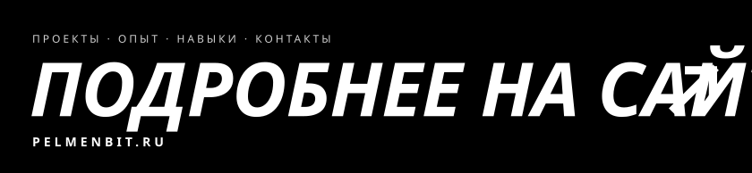

<b>RU</b> · <a href="https://github.com/pelmenbit/pelmenbit/blob/main/README.en.md">EN</a>

<a href="https://pelmenbit.ru/"><picture><source media="(prefers-color-scheme: dark)" srcset="assets/hero-dark.svg"></picture></a>

<a href="https://t.me/pelmenbit"><picture><source media="(prefers-color-scheme: dark)" srcset="assets/btn-tg-dark.svg"></picture></a>
<a href="https://pelmenbit.ru/"><picture><source media="(prefers-color-scheme: dark)" srcset="assets/btn-site-dark.svg"></picture></a>

<picture><source media="(prefers-color-scheme: dark)" srcset="assets/marquee-dark.svg"></picture>

 

<picture><source media="(prefers-color-scheme: dark)" srcset="assets/stack-dark.svg"></picture>

 

<a href="https://pelmenbit.ru/"><picture><source media="(prefers-color-scheme: dark)" srcset="assets/more-dark.svg"></picture></a>
